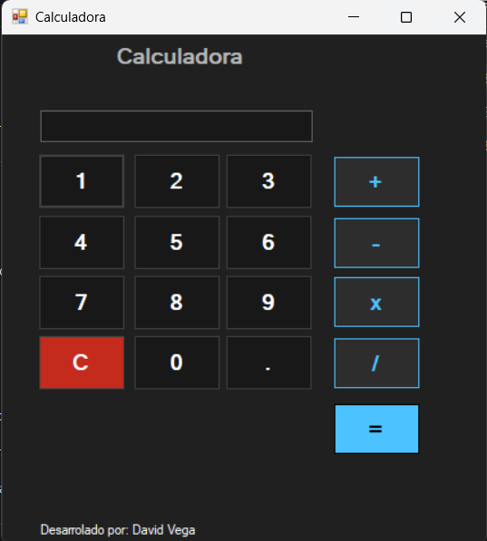
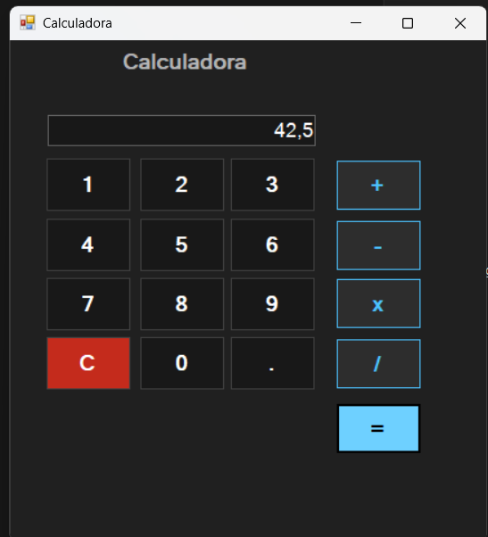
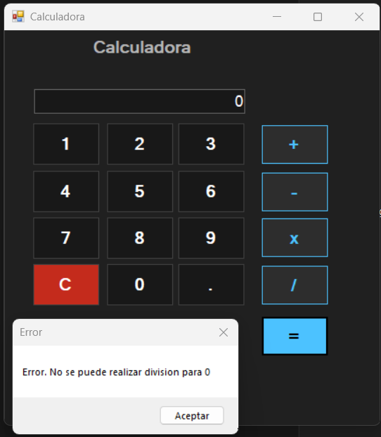

# Calculadora de Escritorio (.NET Windows Forms)

## 1. Descripción general
Este proyecto consiste en una aplicación de escritorio desarrollada en **C#** mediante **.NET Windows Forms** que simula el funcionamiento de una calculadora convencional. Permite realizar operaciones aritméticas básicas de manera intuitiva a través de una interfaz gráfica limpia y estructurada, garantizando la integridad de los datos mediante validaciones de entrada y control de errores.

## 2. Objetivos
* Desarrollar una aplicación de escritorio funcional aplicando los fundamentos de la programación orientada a eventos en C#.
* Diseñar una interfaz gráfica de usuario (GUI) intuitiva, uniforme y visualmente profesional.
* Implementar las operaciones aritméticas fundamentales asegurando la validación de entradas y el manejo adecuado de excepciones (como la división para cero).
* Organizar y documentar un proyecto de software aplicando buenas prácticas de control de versiones en GitHub.

## 3. Características principales
* **Entrada numérica mediante interfaz:** Teclado numérico completo del `0` al `9` (incluyendo punto decimal si aplica) gestionado por eventos centralizados.
* **Operaciones aritméticas básicas:** Soporte para suma (`+`), resta (`-`), multiplicación (`×`) y división (`÷`).
* **Pantalla de visualización segura:** Control `TextBox` configurado en modo solo lectura (`ReadOnly = true`) para evitar alteraciones directas por teclado y prevenir errores de formato.
* **Operaciones consecutivas:** Capacidad para encadenar cálculos o iniciar nuevas operaciones sin necesidad de reiniciar el programa.
* **Función de reinicio (`C`):** Limpieza inmediata de la pantalla y restablecimiento de las variables internas de estado.
* **Validación y manejo de errores:** Protección contra divisiones para cero, operaciones incompletas o conversiones inválidas mediante mensajes comprensibles para el usuario.

## 4. Tecnologías utilizadas
* **Lenguaje de programación:** C#
* **Framework:** .NET
* **Interfaz gráfica:** Windows Forms (WinForms)
* **Entorno de desarrollo (IDE):** Visual Studio 2022
* **Control de versiones:** Git y GitHub

## 5. Requisitos de instalación
Para clonar, compilar y ejecutar este proyecto en un entorno local se requiere:
* Sistema operativo **Windows 10** o **Windows 11**.
* **Visual Studio 2022** (o superior) con la carga de trabajo *"Desarrollo de escritorio de .NET"* instalada.
* **SDK de .NET** compatible con la versión del proyecto (`[Ej: SDK 8.0]`).
* **Git** instalado para clonar el repositorio.

## 6. Instrucciones de ejecución
1. **Clonar el repositorio:** Abre una terminal o consola de Git y ejecuta el siguiente comando (reemplazando con tu URL real):
   ```bash
   git clone https://github.com/DavidVegaPaez/PPE03_Vega_David_Calculadora.git
   ```
2. **Abrir el proyecto:** Navega a la carpeta descargada y haz doble clic en el archivo de solución (`Calculadora.sln`) o abre el proyecto desde Visual Studio.
3. **Compilar y ejecutar:** Presiona la tecla `F5` o haz clic en el botón **Iniciar** (▶) en la barra superior de Visual Studio para compilar y ejecutar la aplicación.

## 7. Estructura del proyecto
```text
PPE03_[Apellido]_[Nombre]_Calculadora/
│
├── Calculadora/
├── Capturas/                 # Carpeta con las imágenes de evidencia del funcionamiento
├── .gitignore                # Exclusión de carpetas temporales (bin, obj, .vs)
└── README.md                 # Documentación técnica del proyecto
```

## 8. Capturas de pantalla

### Interfaz principal


### Ejemplo de operación aritmética


### Manejo de error (División para cero)


## 9. Pruebas realizadas
Se verificó el correcto funcionamiento y estabilidad de la aplicación mediante los siguientes escenarios de prueba:

| # Prueba | Operación / Acción | Resultado esperado | Estado |
| :---: | :--- | :--- | :---: |
| **1** | `10 + 5` | `15` | ✅ Aprobado |
| **2** | `20 - 8` | `12` | ✅ Aprobado |
| **3** | `7 × 6` | `42` | ✅ Aprobado |
| **4** | `100 ÷ 4` | `25` | ✅ Aprobado |
| **5** | `10 ÷ 0` | Mensaje de advertencia ("No es posible dividir para cero") | ✅ Aprobado |
| **6** | Presionar botón `C` tras una operación | Pantalla vacía y variables reiniciadas | ✅ Aprobado |
| **7** | `15 + 25` | `40` | ✅ Aprobado |
| **8** | `3 × 3` y posteriormente `8 + 2` | `9` y luego `10` (operaciones consecutivas) | ✅ Aprobado |

## 10. Autor
* **Nombre:** David Vega
* **Asignatura:** Diseño y Programación de Software
* **Actividad:** PPE09 – Desarrollo de una calculadora de escritorio con .NET Windows Forms

